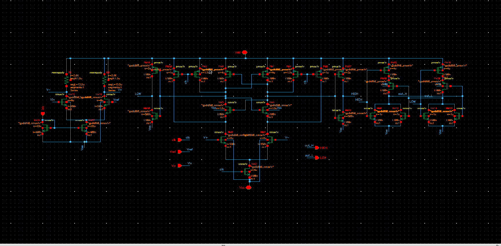
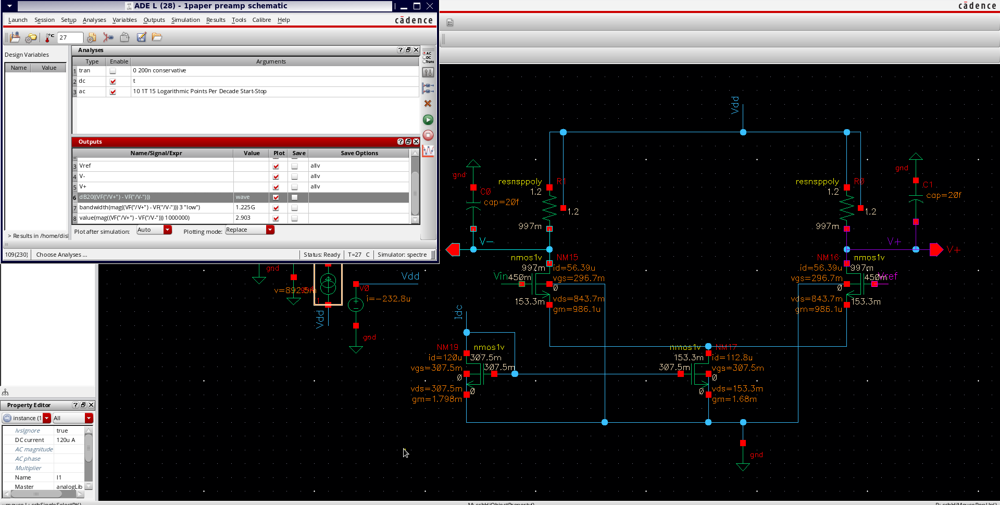
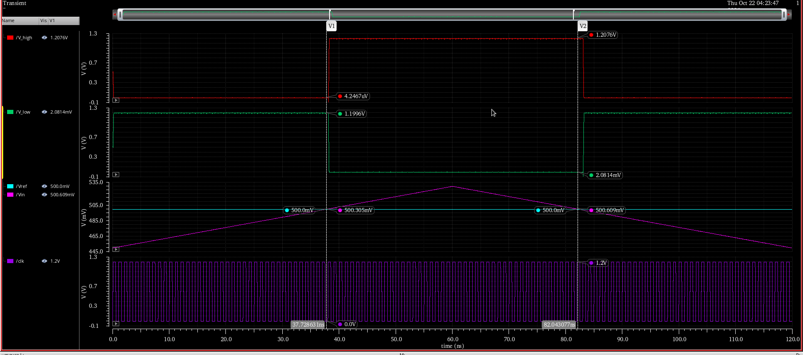
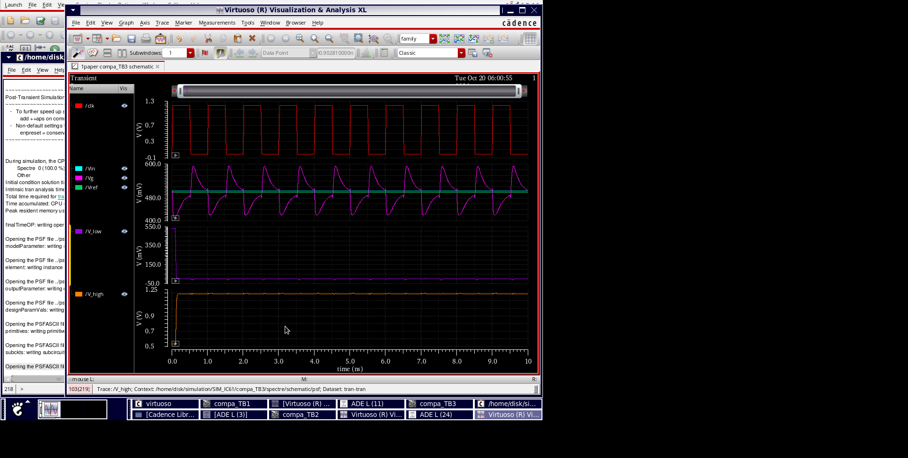
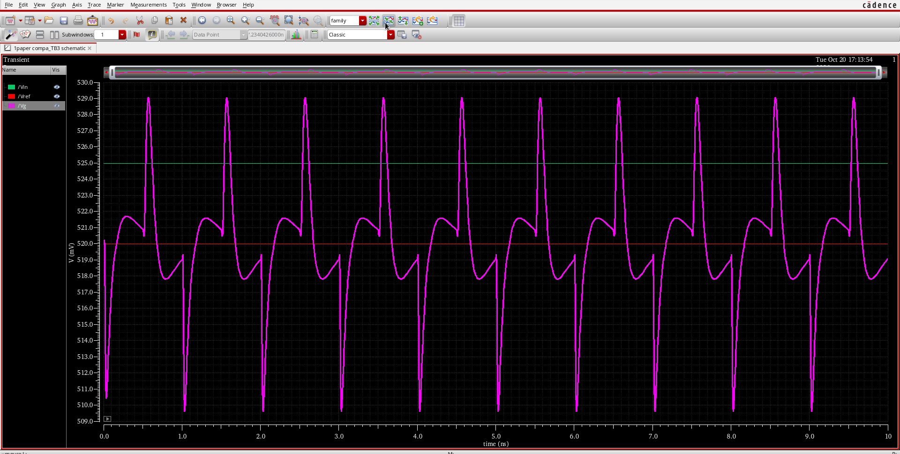
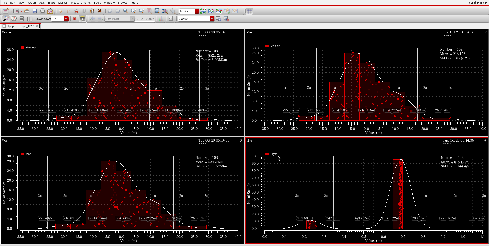
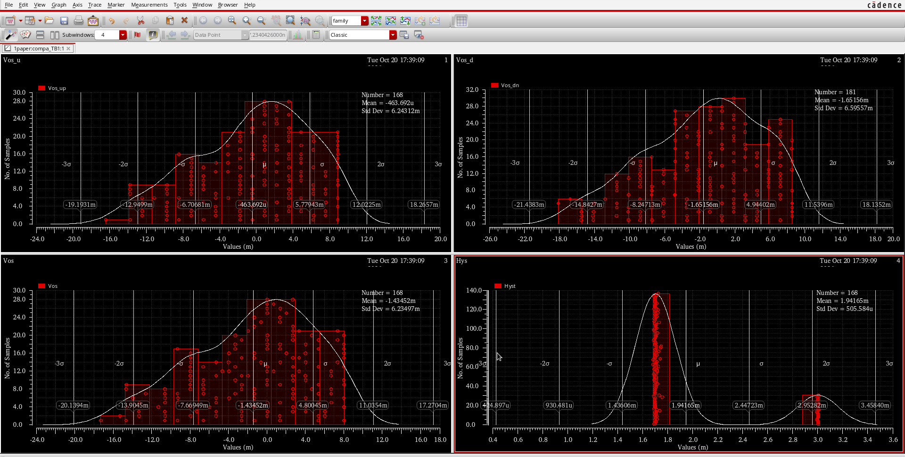

# Preamplified StrongARM Comparator — 1 GS/s, 90 nm CMOS

A clocked comparator cell in Cadence **gpdk090** (90 nm CMOS, 1.2 V): a resistively loaded preamplifier, a StrongARM latch, inverter buffers and a NOR SR latch. Intended as a flash-ADC quantiser driven from a resistor-ladder reference of ~1 kΩ tap impedance, which is why kickback into the reference is specified alongside offset.

**1 GHz clock · σ(offset) = 6.2 mV · 19.5 mV p-p kickback on a 1 kΩ / 100 fF reference · 120 ps clock-to-Q · ≈ 220 µW**

Schematic complete — three cell versions measured, Monte Carlo + corners (layout pending)

- 📄 [Full report (PDF)](report/StrongARM_Comparator_Report.pdf) — including the derivation, testbench expressions and measurement tables.

---

## Results

| Parameter | Target | Achieved | Margin |
|---|---|---|---|
| Technology / supply | gpdk090, 1.2 V | gpdk090, 1.2 V | — |
| Clock | 1 GHz | 1 GHz (functional to 2 GHz) | 2× |
| Input common-mode range | 0.5 – 0.95 V | 0.45 – 0.95 V, gain flat to ±1.5 % | 50 mV below spec floor |
| Input offset, 1σ (mismatch, N = 168) | ≤ 6 mV | 6.2 mV | **−0.2 mV (marginal)** |
| Input offset, nominal | < 1 mV | 15 µV | 66× |
| Hysteresis | < 1 mV | < 0.5 mV | 2× |
| Kickback on 1 kΩ / 100 fF reference | < 20 mV p-p | 19.5 mV p-p | 0.5 mV |
| Clock-to-Q at ΔV = 5 mV | < 300 ps | 120 ps (latch); ≈ 170 ps with preamp | 130 ps |
| Regeneration time | — | 100 ps | — |
| Minimum resolvable input | < 1 mV | < 1 mV | met |
| Power at 1 GHz | < 300 µW | ≈ 220 µW | 80 µW |
| Process corners | FF / SS / SF / FS, −40 – 85 °C | correct decisions, both polarities | met |

All values at tt, 1.2 V, 27 °C unless stated. The one marginal entry is the mismatch offset: 6.2 mV against a 6 mV budget, within 4 % of target. See [Scope and limitations](#scope-and-limitations) for what would close it.

---

## Circuit



Comparator cell. **Left:** resistively loaded preamplifier NM15/NM16 with mirror NM19/NM17 and 3.6 kΩ poly loads. **Centre:** StrongARM latch with input pair NM0/NM1, tail NM2, regenerative pairs NM4/NM5 and PM0/PM1, and four clocked PMOS reset switches. **Right:** inverter buffers and the NOR SR latch that holds the decision through the reset phase.

| Block | Function | Sizing |
|---|---|---|
| Preamplifier | Divides latch offset by its gain, fixes latch common mode at ≈ 1.0 V, isolates the reference from clock edges | NMOS pair 8 µm / 0.2 µm (gm/ID = 17), 3.6 kΩ loads, mirror 25 µm / 0.4 µm at 120 µA |
| StrongARM latch | Dynamic regenerative decision, zero static power | Input pair 6 µm / 0.15 µm, tail 6 µm / 0.1 µm, regen. pairs 1.5 µm (N) / 4 µm (P), reset switches 1 – 2 µm |
| Output stage | Equal loading of both latch outputs, then a held logic level | Inverters PMOS 2 µm / NMOS 0.5 µm → NOR SR latch PMOS 4 µm / NMOS 1 µm |

### Why a preamplifier

Three versions of the cell were measured before it was frozen:

| Version | Offset σ (Monte Carlo) | Kickback on 1 kΩ / 100 fF reference | Clock-to-Q at 5 mV | Power at 1 GHz |
|---|---|---|---|---|
| Bare StrongARM, 4 µm × 0.1 µm pair | 8.7 mV (N = 108) | — | 120 ps | ≈ 75 µW |
| Bare StrongARM, 12 µm × 0.3 µm pair | ≈ 4 mV (N ≈ 80) | **160 mV p-p** | 126 ps | ≈ 120 µW |
| Preamplifier (gain 2.9) + StrongARM — **final** | **6.2 mV** (N = 168) | **19.5 mV p-p** | ≈ 170 ps | ≈ 220 µW |

The large pair meets the offset budget but dumps its charge into the reference at the sampling instant. The preamplifier does three things at once: its gain divides the latch offset referred to the input; its output common mode, Vdd − I·RL/2 ≈ 1.0 V, is independent of the input common mode, so the latch sees the same operating point whether the reference sits at 0.51 V or 0.89 V; and the latch's clock-edge charge injection lands on the preamplifier's 3.6 kΩ drain nodes (recovering in 80 ps) instead of on the reference ladder. Resistor loads were chosen over diode-connected or current-source PMOS because they give a gain set by one resistor, a defined output level without common-mode feedback, and the least output capacitance.

---

## Design approach

Every sizing step traces back to one equation. The StrongARM is a dynamic circuit and is sized by ratios; the preamplifier pair is sized for matching rather than for gm.

| # | Equation | Sets |
|---|---|---|
| 1 | σ_pair = A_VT / √(W·L), A_VT ≈ 4 mV·µm | Offset of any differential pair; 4 µm × 0.1 µm latch pair → 6.3 mV predicted, 8.7 mV measured with regeneration |
| 2 | σ_total = √[(σ_latch / A_p)² + σ_pre²] = √[(8.7 / 2.9)² + 3.2²] ≈ 4.4 mV | Offset budget with preamplifier (measured 6.2 mV) |
| 3 | A_p = gm · R_L = 0.99 mA/V × 3.6 kΩ = 3.6 (measured 2.9) | Preamplifier gain and load resistor |
| 4 | f_3dB = 1 / (2π R_L (C_int + C_latch)) = 1 / (2π × 3.6 kΩ × 48 fF) = 0.92 GHz | Preamplifier bandwidth; C_int = 28 fF/side from a three-point load sweep |
| 5 | A_1 ≈ (gm/I_D) · V_th ≈ 5 – 7 | Sampling-phase gain of the latch; divides input-pair mismatch |
| 6 | τ = C_out / (gm,n + gm,p) ≈ 35 ps ; t_regen ≈ 3τ · ln(Vdd / (A_1 ΔV)) ≈ 100 ps at ΔV = 5 mV | Regenerative pair sizing and resolvable-input speed |

The preamplifier mirror devices are 25 µm × 0.4 µm so the tail current changes by only ±7 % as the input common mode moves from 0.45 V to 0.95 V; at 120 µA the tail keeps 25 mV of saturation margin at the lowest common mode, and the stage draws 145 µW. The excess of measured offset (6.2 mV) over the estimate (4.4 mV) is attributed to mismatch of the 1.5 µm wide poly load resistors, which enters the offset directly, and to current-factor mismatch of the preamplifier pair.

### Testbenches

Three benches share the cell:

| Bench | Stimulus | Measures |
|---|---|---|
| **TB1** | Vin ramped linearly through Vref in both directions, clock at 1 GHz | Offset (mean of up/down flip) and hysteresis (their difference) in one run |
| **TB2** | DC step ΔV above Vref | Clock-to-Q, regeneration time, average power |
| **TB3** | TB2 with 1 kΩ + 100 fF in the Vref path (ladder-tap model) | Kickback disturbance on the reference node |

| Quantity | Expression |
|---|---|
| Offset, up-ramp | `value(VT("/Vin") cross(clip(VT("/V_high") 5n 60n) 0.6 1 "rising")) − Vref` |
| Offset, down-ramp | `value(VT("/Vin") cross(clip(VT("/V_high") 60n 120n) 0.6 1 "falling")) − Vref` |
| Offset / hysteresis | `(Vos_up + Vos_dn)/2` / `Vos_up − Vos_dn` |
| Clock-to-Q | `delay(VT("/clk") 0.6 1 "rising" VT("/V_high") 0.6 1 "rising")` |
| Regeneration time | `delay(VT("/clk") 0.6 1 "rising" abs(VT("/I0/HIGH") − VT("/I0/LOW")) 0.6 1 "rising")` |
| Kickback | `ymax(clip(VT("/Vg") 2n 3n)) − ymin(clip(VT("/Vg") 2n 3n))` |
| Average power | `−average(IT("/V0/PLUS")) × 1.2` |

The `clip()` on the ramp expressions excludes the start-up transient of the SR latch, which otherwise registers a spurious flip at the ramp start in about a fifth of Monte Carlo samples. A clocked comparator can only flip at a clock edge, so a 1.67 mV/ns ramp reads up to one clock period (1.7 mV) of apparent hysteresis; the true value is below the ramp step.

---

## Verification

### Preamplifier — DC operating point and AC response



Operating point at Vcm = 0.45 V, 120 µA: each input device at 56 µA with gm = 0.99 mA/V, tail with 153 mV of drain–source voltage, outputs at 0.997 V. AC response with 20 fF on each output: gain 2.90 (9.3 dB), flat to f3dB = 1.23 GHz. Gain checked over common mode and supply: 2.90 at Vcm = 0.45 V and 2.98 at 0.95 V at nominal, falling to 2.5 – 2.6 at 1.08 V and 85 °C with the tail still saturated above Vcm = 0.5 V.

### Offset and hysteresis — TB1 ramp



Vref = 0.5 V, 1 GHz clock. The SR outputs flip at 500.305 mV on the up-ramp and 500.609 mV on the down-ramp, with flat rails in between: nominal offset ≈ 0.45 mV at the ramp resolution (15 µV from the DC bench), hysteresis < 0.5 mV.

### Kickback — TB3, reference node through 1 kΩ / 100 fF

| Latch alone, 12 µm × 0.3 µm pair | Preamplifier + latch (final) |
|---|---|
|  |  |
| Vg swings ≈ 160 mV p-p on every clock edge — the enlarged pair that met the offset budget | 19.5 mV p-p, recovering within 300 ps of each edge; only the static preamp pair touches the node |

### Corners

The complete cell decides correctly for positive and negative input differences at FF / SS / SF / FS and −40 – 85 °C, including FS — the corner that most unbalances the NMOS/PMOS ratios of the regenerative pairs.

---

## Monte Carlo — mismatch

| Latch alone, 4 µm × 0.1 µm pair (N = 108) | Preamplifier + latch, final (N = 168) |
|---|---|
|  |  |

| Parameter | Latch alone | Preamp + latch (final) |
|---|---|---|
| Offset σ | 8.68 mV | **6.23 mV** |
| Offset mean | 0.53 mV | −1.43 mV |
| Hysteresis mean / σ | 0.64 mV / 0.14 mV | 1.94 mV / 0.51 mV (ramp-step limited, true value < 0.5 mV) |

Each panel shows up-ramp offset, down-ramp offset, their mean (the reported offset) and their difference (hysteresis). The final cell shows no outliers across 168 samples; the whole population sits within ±3σ.

---

## Two findings worth highlighting

1. **The large-pair latch trades offset for kickback one-for-one.** Enlarging the StrongARM input pair nine-fold (4 µm × 0.1 µm → 12 µm × 0.3 µm) halved the mismatch offset to ≈ 4 mV, but its gate charge at the sampling edge put 160 mV p-p on a 1 kΩ reference tap — a disturbance far larger than any LSB a comparator of this offset class could serve. A gain-2.9 preamplifier gives most of the offset benefit (6.2 mV) while cutting the kickback by 8× (19.5 mV), because the latch's clock edges now land on the preamplifier's 3.6 kΩ drains instead of on the reference.

2. **Hysteresis was an output-stage artefact, not a latch property.** With NAND SR gates wired directly to the StrongARM outputs, the state-dependent input capacitance of whichever gate was low produced ±10 mV of hysteresis. Inserting inverter buffers so both latch outputs see an identical load regardless of the stored state reduced it to 0.1 mV.

---

## Scope and limitations

- **Offset σ = 6.2 mV is marginal** against the 6 mV budget. Wider load resistors and a 16 µm × 0.3 µm preamplifier pair, or one-time capacitive offset trimming in the latch, would bring it to the 4 mV budget.
- **Clock-to-Q of the complete cell** (preamp + latch, ≈ 170 ps) is estimated from the preamp bandwidth and the latch measurement, not re-measured.
- **Input-referred noise** was estimated (≈ 0.5 mV rms) but not simulated with transient noise.
- **The 120 µA bias is an ideal source.**
- **Schematic only** — no layout, DRC/LVS or post-layout extraction yet. Planned: mirror-symmetric latch halves.

---

## Repository structure

```
README.md
.gitignore
report/
  StrongARM_Comparator_Report.pdf       full write-up (6 pages)
  StrongARM_Comparator_Report.docx
schematic/
  01_comparator_cell_preamp_strongarm_sr.png
simulation/
  preamp/        DC operating point, AC gain and bandwidth (ADE L)
  offset/        TB1 — offset and hysteresis ramp at Vref = 0.5 V
  monte_carlo/   latch alone (σ = 8.7 mV, N = 108), preamp + latch (σ = 6.2 mV, N = 168)
  kickback/      TB3 — reference-node disturbance without (160 mV) and with (19.5 mV) preamp
```

## Tools

Cadence Virtuoso (ADE L / ADE XL), Spectre, gpdk090 PDK.

## References

1. B. Razavi, "The StrongARM Latch," *IEEE Solid-State Circuits Magazine*, vol. 7, no. 2, pp. 12–17, 2015.
2. B. Razavi, *Design of Analog CMOS Integrated Circuits*, 2nd ed. McGraw-Hill, 2016.
3. M. J. M. Pelgrom, A. C. J. Duinmaijer and A. P. G. Welbers, "Matching properties of MOS transistors," *IEEE J. Solid-State Circuits*, vol. 24, no. 5, pp. 1433–1440, 1989.
4. P. Nuzzo, F. De Bernardinis, P. Terreni and G. Van der Plas, "Noise analysis of regenerative comparators for reconfigurable ADC architectures," *IEEE Trans. Circuits Syst. I*, vol. 55, no. 6, pp. 1441–1454, 2008.

---

*Mohit Kumar Gupta — B.Tech ECE, NIT Andhra Pradesh*
